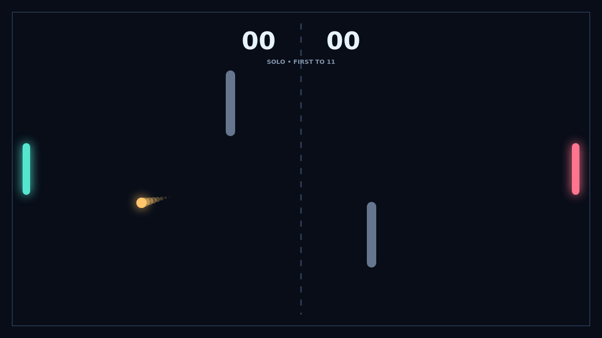

# Carom

A rally opens at center with a short serve countdown. Meet the ball with your paddle and send it back across the dark court; every clean return makes the next exchange faster.

Your paddle's movement becomes spin at impact. Slide down through the contact to bend the ball downrange, or move up to curl it toward the opposite corner. A still paddle sends a steady, readable return.

Two solid obstacles split the court into bank shot lanes. A ball can skim a face, change direction, then curve around the next obstacle before the opponent can recover. Every rally is a small geometry puzzle under pressure.

Score by getting the ball past the far edge. The first to eleven wins, but at ten all the rally continues until someone earns a two point lead.

